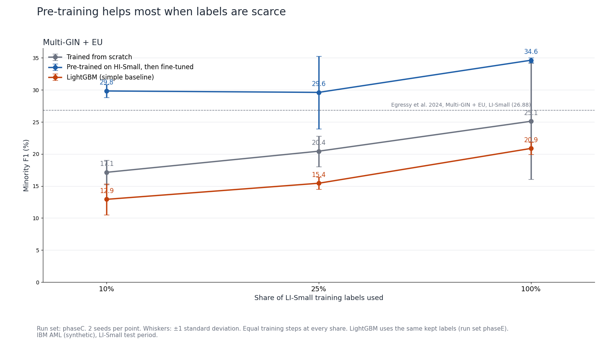
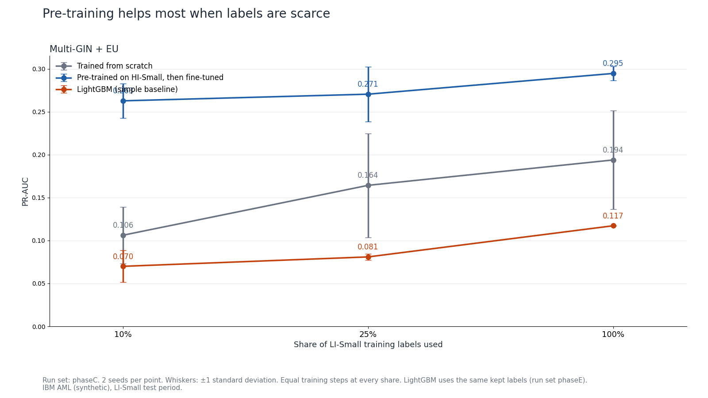
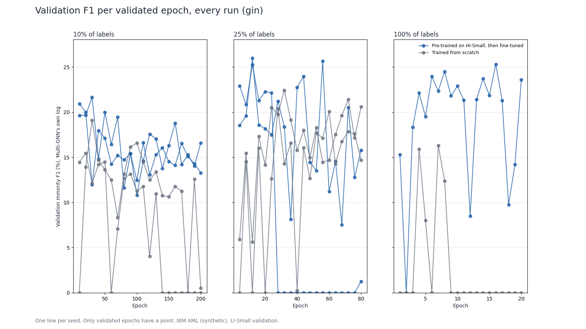
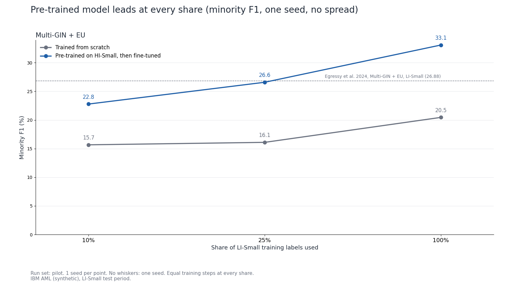
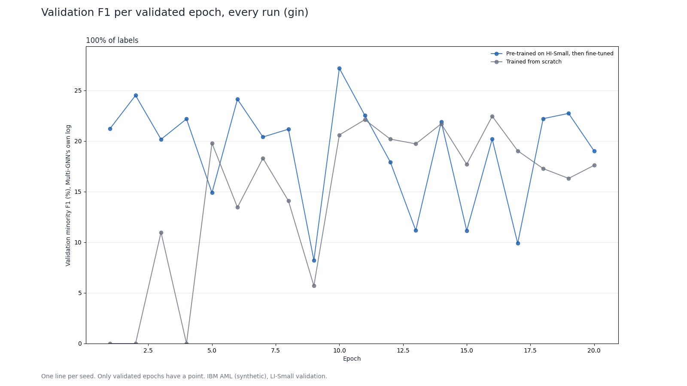

# AML GNN Transfer

Does pre-training a graph neural network on synthetic AML data reduce how many labelled laundering cases a bank needs?

**Status: pilot, Phases B, A, C and E done (GIN only, two seeds in Phase C; LightGBM simple baseline in Phase E); Phase D (PNA, seed 0, budget 16) is set up, not yet run.** Phase C is the first answer to RQ2, with only two seeds.

Docs: [PRD](PRD.md) · [Architecture](ARCHITECTURE.md) · [Design system](DESIGN_SYSTEM.md) · [Agent instructions](AGENTS.md)

## The question

Banks have very few confirmed laundering cases to learn from. IBM's AML paper tested a fix: train a graph network on one synthetic dataset (HI-Small), then fine-tune it on another (LI-Small).

| Model (minority F1, %) | LI-Small |
| --- | --- |
| PNA trained on HI-Small only | 0.00 |
| PNA + 5 epochs fine-tuning on LI-Small | 27.38 |

Source: Altman et al. (2023), Table 3. The paper does not say how much LI-Small data the fine-tune used.

**This project measures that:** at 10%, 25%, 50% and 100% of LI-Small's training labels, how does a pre-trained-and-fine-tuned model compare with one trained from scratch?

## Plan

1. **Reproduce** IBM's results with their own code ([IBM/Multi-GNN](https://github.com/IBM/Multi-GNN)): Multi-GIN + EU and Multi-PNA + EU on HI-Small, then the transfer to LI-Small.
2. **Label scarcity:** hide the labels of 90%, 75%, 50% or 0% of LI-Small's training transactions (every transaction stays in the graph), and compare scratch vs fine-tuned. Three seeds each, 24 runs.
3. **Compare** with the LightGBM pipeline from [aml-ibm-experiment](https://github.com/coachuttam/aml-ibm-experiment) on LI-Small.
4. **Write up** the answer, with the chart and limits.

### How runs are compared: equal training steps

With 10% of the labels, an epoch has about a tenth of the gradient steps. Giving every fraction the same number of epochs would starve the small ones. So the training budget is counted in **steps**, not epochs:

- The budget is the steps in N epochs at 100% of the labels. N is `STEP_BUDGET_EPOCHS` in `src/config.py` (5, IBM's fine-tuning setting), or `--step-budget-epochs` on the command line.
- A smaller fraction runs proportionally more epochs, so every run gets about the same number of steps.

| Share of labels | 100% | 50% | 25% | 10% |
| --- | --- | --- | --- | --- |
| Epochs (N = 5) | 5 | 10 | 20 | 50 |

- Trained from scratch and pre-trained-then-fine-tuned runs at the same fraction get the same budget and the same kept labels. The only difference is the starting weights.
- Multi-GNN runs whole epochs, so step totals match to within one batch per epoch. Each run record stores its actual step count.
- The checkpoint is the epoch with the best validation F1. Test is not scored during training.
- Validation is run **the same number of times for every fraction** (as many passes as the budget has epochs, evenly spread, always ending on the last epoch), because each pass over LI-Small takes about three minutes. Epochs in between log "not scored" and cannot be picked as best. Multi-GNN never saves a checkpoint after epoch 0, so at 100% (where epoch 0 is itself a validation point) there is one fewer candidate epoch than at smaller fractions.
- Building the graph (reading the CSV, adding ports) is done once per dataset and cached (`src/graph_cache.py`); training and scoring reuse it.
- A limit to keep in mind: the same small budget may leave a model trained from scratch underfitted, so it can be a weak baseline.

Every run is scored with minority F1 (to compare with IBM) and with PR-AUC, precision in the top 100 and recall at an alert budget (to compare with Project 2). Thresholds and epochs are chosen on validation; test is scored once.

### The Colab pilot (a first, smaller pass)

Compute is limited, so the first results come from a **pilot**, not the full design. Every number from it is labelled "pilot".

| | Pilot | Deferred to v2 |
| --- | --- | --- |
| Model | GIN + EU | PNA + EU |
| Source model | one HI-Small model, seed 0 | one per seed |
| Label fractions | 10%, 25%, 100% | 50% |
| Seeds | 0 for now (seed 1 added after seeing scratch's 100% curve) | 1, 2 |
| Step budget | 8 epochs at 100% (3 was too few) | 5 (IBM's fine-tuning setting) |
| Source model | 10 epochs on HI-Small, seed 0 | |
| Runs | 1 source + 6 (scratch and finetune); 12 if seed 1 is added | 24 |
| Loss weights, learning rate | IBM's defaults for both setups | a weight sweep |

Limits that come with it:
- If Colab disconnects, a run that had finished training but not scoring is scored from its saved checkpoint (a `training_complete.json` marker proves training finished; its record says `scoring_resumed`). A run interrupted mid-training is set aside and started again.
- With one seed there is **no spread at all**: a gap between scratch and finetune cannot be called a result, only a lead. Seed 1 would give two points, still thin.
- Any seed fine-tunes from the **same** source model, so the finetune spread would leave out pre-training variance.
- The budget was raised from 3 to 8 epochs because scratch was still improving at 3. Whether 8 is enough is read from scratch's 100% validation curve; if it is still rising, the pilot says so.
- The first runs at budget 3 (source kept; scratch and finetune at 100%, scratch at 25%) are kept in `superseded/` folders and are not in the results.
- If scratch at a low fraction collapses to predicting no laundering, it is recorded as `no_improvement` and reported as a finding. IBM's loss weights and learning rate are not changed; a weight sweep is v2.
- The source model's epochs (`PILOT_SOURCE_EPOCHS`) are the owner's call, made after reading `python -m src.estimate_pilot`.

Pilot records are kept in `results/pilot/`, apart from `results/runs/`, so v2 runs can never overwrite them. Run it with `notebooks/colab_runner.ipynb` (`RUN_FULL = True` only after approval).

### What the first pilot logs showed (observations, not results)

These come from the first four pilot runs (seed 0, 3-epoch budget, since superseded by budget 8), read from the Colab logs. They are validation F1 only, one seed, three validation points each. They are not comparisons.

- **Fine-tuning converges much faster.** Fine-tuning from the HI-Small model started near its plateau (validation F1 0.19, 0.11, 0.19 over three validations at 100% of the labels), while the scratch run started at 0.00 and was still rising (0.00, 0.05, 0.14). So 3 epochs favours fine-tuning: it measures speed to a plateau, not where scratch would end up. This is why the budget is being raised.
- **The source model is unstable.** On HI-Small, validation F1 went 0.22, then 0.50 at epoch 9, then 0.31. The best-validation checkpoint keeps the 0.50 epoch, but a noisy source model means the transfer result depends on which epoch was saved.
- **Scratch can collapse at fewer labels.** At 25% of the labels, scratch training F1 fell to 0.0000 from epoch 2 and validation F1 stayed 0.0000, so no checkpoint was saved. A run like that is recorded with `status: "no_improvement"` and minority F1 0.0 (test not scored), instead of crashing. It is a finding about training from scratch with few positive labels, not a missing result.
- **Loss weights are IBM's defaults.** GIN's loss weights the laundering class 6.275 to 1 (`model_settings.json`, copied unchanged into each run and stored in every record under `multignn_settings`). That is far below the real imbalance (about 1 laundering row in 2,000), so the weight does not correct for it. We have not changed it; doing so would leave IBM's published setting.

### How a run can end

`config.status` in every record is `completed` (a checkpoint was scored) or `no_improvement` (training finished but no epoch after the first had validation F1 above 0, so Multi-GNN saved nothing). For `no_improvement`, minority F1, precision and recall are recorded as 0.0 and every other metric as null, because test was not scored. Collect tables must show these runs, not drop them.

If a pilot run's step budget changes, records and models made at the old budget are moved to `superseded/` folders, not overwritten or deleted, and those runs are done again.

## Results

### Phase C (GIN, 10/25/100% of labels, seeds 0 and 1, budget 20)

Pre-training helps most when labels are scarce: it gave a higher test minority F1 than training from scratch at all three label shares, and the gap is largest at 10% of the labels (12.7 points, against 9.2 at 25% and 9.5 at 100%, where the 100% gap is within the scratch spread). At 10% of the labels the fine-tuned model scored 29.8 against 17.1, and its 10% score is above the 26.88 that Egressy et al. (2024) report for Multi-GIN + EU on LI-Small (their number, not ours). Only two seeds were run, so the spread below is a rough guide.





Test period of LI-Small, mean ± standard deviation over 2 seeds, equal gradient steps in every pair (10,840 to 11,000), same kept labels for both systems at each share and seed. F1 and recall are test values; the threshold comes from validation.

| Labels | System | Minority F1 | PR-AUC | Precision@100 | Recall@10k |
| --- | --- | --- | --- | --- | --- |
| 10% | From scratch | 17.1 ± 1.9% | 0.106 ± 0.033 | 0.44 ± 0.07 | 43.6 ± 12.2% |
| 10% | Pre-trained, fine-tuned | 29.8 ± 1.0% | 0.263 ± 0.020 | 0.92 ± 0.01 | 54.6 ± 3.6% |
| 25% | From scratch | 20.4 ± 2.4% | 0.164 ± 0.061 | 0.66 ± 0.22 | 49.8 ± 0.6% |
| 25% | Pre-trained, fine-tuned | 29.6 ± 5.7% | 0.271 ± 0.032 | 0.91 ± 0.01 | 58.5 ± 3.8% |
| 100% | From scratch | 25.1 ± 9.1% | 0.194 ± 0.057 | 0.76 ± 0.16 | 41.5 ± 0.0% |
| 100% | Pre-trained, fine-tuned | 34.6 ± 0.4% | 0.295 ± 0.008 | 0.97 ± 0.03 | 58.8 ± 0.1% |

Per-seed minority F1 (%): 10% scratch 15.8 and 18.5, fine-tuned 30.5 and 29.1; 25% scratch 18.7 and 22.1, fine-tuned 33.6 and 25.6; 100% scratch 31.5 and 18.7, fine-tuned 34.9 and 34.4. The 100% runs for seed 0 are the Phase A runs (`_b20`), reused.

What this does and does not show:
- **Fine-tuning is higher in every pair of runs** (same seed, same labels), and the gaps at 10% and 25% are larger than the spread. This is two seeds on one dataset pair of synthetic data, so it is not a statistical test.
- **The 100% gap rests on one unstable scratch run.** Scratch scored 31.5 at seed 0 and 18.7 at seed 1, so its whisker touches the fine-tuned mean. We do not call the 100% gap a clear win.
- **Fine-tuned F1 does not fall with fewer labels here** (29.8 at 10%, 29.6 at 25%), but 10% to 25% is inside the 25% spread (5.7). We have not shown that 10% of the labels is enough.
- **One source model.** Every fine-tune starts from the same HI-Small model, so pre-training variance is not in the spread.
- **Test F1 and validation F1 differ.** The table is test. Validation F1 (threshold chosen there) is in `results/summary.csv` as `val_minority_f1`, and the two differ in both directions: validation is higher than test for most scratch runs and lower for most fine-tuned runs.
- **Validation is noisy.** The chart below shows Multi-GNN's own validation F1 for every Phase C run (one line per seed). It swings by 10 points or more between epochs, and some runs fall to 0 after a good start: scratch at 100% (seed 1) is at 0 from epoch 9 on, and fine-tune at 25% (seed 1) is at 0 from epoch 28 to 76. The records score the best saved checkpoint (scratch 100% seed 1: epoch 7), so the table is not hit, but this explains the wide scratch spread.



### Pilot (GIN, one seed): a first look, not a result

Multi-GIN + EU, seed 0, step budget 8 epochs at 100% of labels (equal gradient steps at every share), one shared HI-Small source model (10 epochs). Test period of LI-Small, threshold chosen on validation, test scored once. Records: `results/pilot/records/`; table: `results/summary.csv`; charts: `results/pilot/`.

| System | Labels | Seeds | Epochs (best/run) | Minority F1 | PR-AUC | Precision@100 | Recall@25k |
| --- | --- | --- | --- | --- | --- | --- | --- |
| Trained from scratch | 10% | 1 | 60/80 | 15.7% | 0.072 | 35.0% | 46.4% |
| Pre-trained on HI-Small, then fine-tuned | 10% | 1 | 40/80 | 22.8% | 0.165 | 76.0% | 59.4% |
| Trained from scratch | 25% | 1 | 24/32 | 16.1% | 0.095 | 44.0% | 56.4% |
| Pre-trained on HI-Small, then fine-tuned | 25% | 1 | 4/32 | 26.6% | 0.276 | 92.0% | 69.0% |
| Trained on HI-Small (scored on HI-Small test) | 100% | 1 | 9/10 | 60.5% | 0.571 | 91.0% | 84.2% |
| Trained from scratch | 100% | 1 | 7/8 | 20.5% | 0.210 | 83.0% | 66.8% |
| Pre-trained on HI-Small, then fine-tuned | 100% | 1 | 8/8 | 33.1% | 0.280 | 90.0% | 74.1% |



The fine-tuned model scores higher than the one trained from scratch at 10%, 25% and 100% of the labels (22.8 vs 15.7, 26.6 vs 16.1, 33.1 vs 20.5 minority F1). **With one seed this is a lead, not a result**: there is no spread to compare the gaps against, so none of them is called a win.

For scale, Egressy et al. (2024) report 26.88 minority F1 for Multi-GIN + EU on LI-Small (this is their number, not ours, and it is the line on the chart). Altman et al. (2023) report 27.38 for PNA after fine-tuning. We have not yet reproduced either.

Caveats:
- **One seed.** No standard deviation exists. Phase C adds seeds 0, 1 and 2.
- **Budget 8.** Both 100% runs were still near their best at the last epoch (best validation epoch 8 of 8 for fine-tune, 7 of 8 for scratch), so 8 epochs may be too short, most of all for scratch. Phase A reruns both at budget 20.
- **One source model.** Every fine-tune starts from the same HI-Small model (seed 0), so a spread over seeds would leave out pre-training variance. That source model's validation F1 was unstable between epochs.
- **No validation numbers in the pilot records.** They were written before records carried validation metrics and curves. New records carry both; `python -m src.export_curves` can make curve files for the pilot from the Drive logs.
- **Thresholds.** The alert threshold is the best-F1 threshold on the validation period, as in Project 2.
- **Superseded runs.** The first runs at budget 3 are kept in `results/pilot/records/superseded/` and are not in the table.

### Phase B and Phase A (GIN, 100% of the labels, one seed)

| System (LI-Small test) | Minority F1 | PR-AUC | Precision@100 | Recall@10k | Best epoch | Units |
| --- | --- | --- | --- | --- | --- | --- |
| Trained on HI-Small only (zero-shot) | 0.3% | 0.001 | 0.00 | 0.2% | n/a | 0.11 |
| Pilot, budget 8: from scratch | 20.5% | 0.210 | 0.83 | 56.4% | 7 of 8 | 2.31 |
| Pilot, budget 8: pre-trained, fine-tuned | 33.1% | 0.280 | 0.90 | 58.1% | 8 of 8 | 2.31 |
| Phase A, budget 20: from scratch | 31.5% | 0.235 | 0.87 | 41.5% | 16 of 20 | 5.54 |
| Phase A, budget 20: pre-trained, fine-tuned | 34.9% | 0.300 | 0.99 | 58.7% | 10 of 20 | 5.58 |

Units are run time x the L4 rate (1.94 units per hour) from each record. One seed per row, so no gap here is called a win.

- **Zero-shot does not work.** The HI-Small model scored on LI-Small finds 56% of laundering but raises 293,581 alerts (precision 0.15%). The two datasets differ too much for the model to be used as it is; only fine-tuning transfers anything.
- **Scratch needed more steps.** At budget 20, scratch rises from 20.5% to 31.5% F1 and its best epoch moves from 7 to 16. Fine-tune moves less (33.1% to 34.9%) and peaks at epoch 10. The 100% gap shrinks from 12.6 to 3.4 F1 points, so the pilot's large gap was partly a short budget. Still one seed.
- **Plateau (validation, Phase A).** Plateau = first epoch whose validation F1 is within 0.01 of the run's best. This is Multi-GNN's own argmax F1 on the LI-Small validation period, not the threshold-tuned F1 in the table.

| Arm | Best validation epoch (F1) | Plateau epoch |
| --- | --- | --- |
| Trained from scratch | 16 (22.5%) | 11 |
| Pre-trained, then fine-tuned | 10 (27.2%) | 10 |



Neither arm improves after epoch 16, and both best epochs fall inside 16. Validation F1 swings by 10 points or more from one epoch to the next (fine-tune drops to 8.2% at epoch 9 and 9.9% at epoch 17), so the plateau epoch is a rough guide from one seed. Phase C at budget 16 is the cheaper choice and covers both best epochs; budget 20 costs about 2 more units but lets Phase C reuse the two Phase A runs.

### Phase E: LightGBM, a simple baseline (6 runs, seeds 0 and 1)

LightGBM scored well below both GNN setups at every label share, so it is labelled a **simple baseline**. It is not a tuned or competitive tabular model; it only shows what plain account-history features reach on the same kept labels.

| Labels | Minority F1 | PR-AUC | Precision@100 | Recall@10k |
| --- | --- | --- | --- | --- |
| 10% | 12.9 ± 2.4% | 0.070 ± 0.019 | 0.28 ± 0.30 | 48.1 ± 4.7% |
| 25% | 15.4 ± 1.0% | 0.081 ± 0.004 | 0.32 ± 0.05 | 46.3 ± 1.9% |
| 100% | 20.9 ± 1.0% | 0.117 ± 0.000 | 0.46 ± 0.04 | 54.7 ± 7.4% |

Test period of LI-Small, mean ± standard deviation over 2 seeds (at 100% both seeds see the same labels, so their spread is small and says little). Same split and kept labels as Phase C (each run's kept-label fingerprint is checked against the Phase C records). For comparison, fine-tuned GIN reached 29.8 / 29.6 / 34.6% and scratch GIN 17.1 / 20.4 / 25.1% at the same shares (Phase C above). The chart above carries the LightGBM line.

What was checked before reporting it:
- **First version (Project 2's 16 features and settings):** test F1 was flat at about 0.12 and lowest at 100%. Early stopping mostly was not halting too early: with up to 2000 trees and patience 100 it stopped at the same tree at 10% and 25%, and validation PR-AUC peaks after 37 to 152 trees and then falls. At 100% more patience did help (37 to 268 trees, validation PR-AUC 0.037 to 0.051). The features were weak on LI-Small: the best single feature (7-day payments received) has a validation PR-AUC of 0.008 against a base rate of 0.0006, and most features are near 1x.
- **Fix, chosen on validation only** (`python -m src.lgbm_tune`, table in `results/phases/phaseE/tuning_val.csv`, three cells: 10%, 25%, 100% at seed 0): mean validation PR-AUC went from 0.047 (first version) to 0.104. Most of the gain came from 13 extra past-only features (new counterparties in 24 h and 7 d, how many accounts the receiver pays on, account history and amount against the account's usual amount); more trees and patience alone gave 0.052, lower class weights 0.063, extra features alone 0.086, both together 0.104. Regularising (15 leaves, larger leaves, subsampling) did worse (0.069).
- **Test was scored once per run, for the final settings only.** The first version's records are kept in `results/phases/phaseE/records/superseded/` and are not in the tables. We had seen the first version's test numbers before choosing to tune it, and nothing in the choice used test rows.

| Validation, mean of the 3 cells | First version | Final |
| --- | --- | --- |
| PR-AUC | 0.047 | 0.104 |
| Best F1 (tuned on validation, so optimistic) | 0.101 | 0.176 |

Test F1 (mean over seeds) went from 12.2 / 12.4 / 11.6% to 12.9 / 15.4 / 20.9% at 10 / 25 / 100%, and now rises with the share of labels. At 10% the gain is within the seed spread.

**Limits.** Features are still simple: 29 columns from timestamps, accounts, amounts and formats, with no graph embeddings. The settings were chosen from 7 candidates on 3 cells. LightGBM alone says nothing about whether a better tabular model could match the GNN.

**SHAP.** `python -m src.lgbm_explain` writes the top-5 SHAP reasons for the 100 highest-scored test alerts of the 10% seed 0 run (`reason_codes_f0.1_s0.csv`) and a summary plot (`shap_summary_f0.1_s0.png`). The most common reasons are payment format, payments sent in 7 days and first-time pairs.

To run: put `LI-Small_Trans.csv` in `data/Small_LI/` (copy it from Drive `aml-gnn-transfer/data/Small_LI/`, or `python -m src.download_data` with a Kaggle token), then `python -m src.lgbm_run` (add `--simple` for the first version). On a Mac without Homebrew, LightGBM needs an OpenMP library; see the note under Quick start.

### Phases A to D

All run from `notebooks/colab_runner.ipynb` by setting `RUN_SET` in its first cell. Sets are described in `configs/phases.yaml`; the numbers behind them are named constants in `src/config.py`.

| RUN_SET | What it runs | Runs |
| --- | --- | --- |
| `phaseB` (done) | Zero-shot: the pilot's GIN source model scored on LI-Small test, no training. The threshold is chosen on LI-Small validation (one number, so slightly generous to zero-shot) | 1 |
| `phaseA` (done) | GIN, 100% labels, scratch and fine-tune, budget 20, every epoch validated (ids end `_b20`; the pilot is not touched) | 2 |
| `phaseC` | GIN, fractions in `PHASE_C_FRACTIONS` (10/25/100%) x scratch/fine-tune x seeds in `PHASE_C_SEEDS` (0, 1), nested label masks, at `BUDGET_C`. Finished pilot runs (budget 8) or Phase A runs (budget 20) are reused when `BUDGET_C` matches, not re-run | 12 (6 to run at budget 8, 12 at 16, 10 at 20) |
| `export_curves` | No GPU: rebuilds the validation curves of the pilot and Phase A from their Multi-GNN logs on Drive, into `pilot/curves/` and `phaseA/curves/` | 0 |
| `phaseD` | Train `pna_source_f1.0_s0` on HI-Small (Multi-PNA + EU, 10 epochs), then 10/25/100% x scratch/fine-tune with PNA at `BUDGET_D` (16), seed 0 (`PHASE_D_FRACTIONS`, `PHASE_D_SEEDS`) | 7 |

`BUDGET_C` is 20 (set after reading Phase A); Phases C and D refuse to start without it. Every run prints an estimate, then its real minutes and Colab units with a running total, and a run expected to pass 3 GPU hours stops unless the owner has approved it (`ALLOW_LONG_RUNS`). A finished run (record with status `completed` or `no_improvement`) is skipped on a re-run, and each finished scratch/fine-tune pair is checked for identical kept labels and equal gradient steps.

Phase D estimate (L4, 1.94 units/h; PNA time is assumed 1.5x GIN, not measured): PNA source about 1.6 h (3.2 units); each of the six comparison runs about 3.5 h (6.8 units), so each needs `ALLOW_LONG_RUNS`; total about 22.7 h and 44 units. If PNA is 2x GIN the total is about 59 units. The first PNA run's real time replaces the assumption.

Tables and charts for any set: `python -m src.collect` then `python -m src.plot --run-set phaseC` (mean ± standard deviation over seeds, one panel per model, plus validation curves for runs that have them).

## Quick start

GNN training needs a GPU (Kaggle or Colab). The laptop handles results, charts and tests.

```bash
git clone --recurse-submodules https://github.com/coachuttam/aml-gnn-transfer.git
cd aml-gnn-transfer
python3 -m venv .venv && source .venv/bin/activate
pip install -r requirements.txt
python -m pytest -q
```

On Kaggle: open `notebooks/kaggle_runner.ipynb`, attach the [IBM AML dataset](https://www.kaggle.com/datasets/ealtman2019/ibm-transactions-for-anti-money-laundering-aml), switch the GPU on, and run the cells.

On Colab: open `notebooks/colab_runner.ipynb`, put your Kaggle token at `aml-gnn-transfer/kaggle.json` in Drive, switch the GPU on, set `RUN_SET` in the first cell and run the cells. It starts as a smoke test (`RUN_SET = "smoke"`); the notebooks are written by `python -m tools.make_notebooks`. The Kaggle token stays on Drive and is never committed.

LightGBM on a Mac without Homebrew (Phase E): `import lightgbm` fails with "Library not loaded: libomp.dylib". Either `brew install libomp`, or point the library at another copy, for example Anaconda's:

```bash
L=.venv/lib/python3.9/site-packages/lightgbm/lib/lib_lightgbm.dylib
install_name_tool -add_rpath "$HOME/anaconda3/lib" "$L" && codesign --force -s - "$L"
```

## Related projects

- [aml-alert-investigator](https://github.com/coachuttam/aml-alert-investigator): fine-tuned LLM copilot for AML alert triage.
- [aml-ibm-experiment](https://github.com/coachuttam/aml-ibm-experiment): LightGBM ranking vs rules on IBM HI-Small.

## Sources

- Altman, E. et al. (2023). [Realistic Synthetic Financial Transactions for Anti-Money Laundering Models](https://arxiv.org/abs/2306.16424). NeurIPS Datasets and Benchmarks.
- Egressy, B. et al. (2024). [Provably Powerful Graph Neural Networks for Directed Multigraphs](https://arxiv.org/abs/2306.11586). AAAI.
- [IBM/Multi-GNN](https://github.com/IBM/Multi-GNN), Apache 2.0.

All data is synthetic (IBM). This is a research prototype, not a production system.
